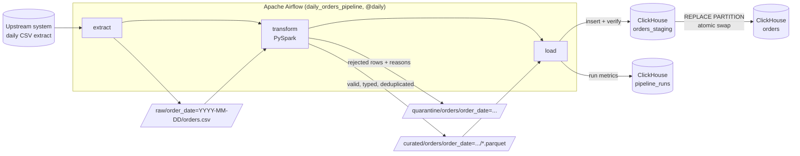

# Batch Data Pipeline — Airflow · PySpark · ClickHouse

[](https://github.com/the-iconic-rihan/batch-data-pipeline/actions/workflows/ci.yml)


> **In one sentence:** every day this pipeline picks up ~1 million raw order records, cleans and checks them,
> throws out the bad ones (and says why), and loads the rest into an analytics database. If anything goes
> wrong, nothing half-finished is ever shown to users, and the same day can be re-run safely.

It mirrors the kind of pipelines I build at work (Python ETL into ClickHouse, PySpark, Airflow, Docker)
as a small, self-contained project you can run on a laptop with one command.

## At a glance

| | |
|---|---|
| **Volume** | ~1M rows per daily run (configurable) |
| **Stack** | Apache Airflow 2.10, PySpark 3.5, Parquet, ClickHouse 24.8, PostgreSQL, Docker Compose |
| **Data quality** | 7 validation rules; bad rows quarantined with reasons; run fails if > 5% of rows are bad |
| **Reliability** | Idempotent re-runs, atomic partition swap in ClickHouse, retries with exponential backoff |
| **Incremental** | One run = one day partition; history loaded on purpose with `make backfill` |
| **Observability** | Every run writes its row counts, error counts and timings to a `pipeline_runs` table |
| **CI/CD** | GitHub Actions: lint, unit tests incl. PySpark, Docker build, DAG integrity test |
| **Setup** | `make up`, then open http://localhost:8080 |

## Architecture



| Step | What it does | Code |
|---|---|---|
| **extract** | Lands the day's raw CSV. A generator stands in for the upstream system and deliberately injects ~1% broken rows and ~0.5% re-sent orders, so there is real cleaning work. Files are written to a temp name and renamed, so readers never see a half-written file. | [`pipeline/generate.py`](pipeline/generate.py) |
| **transform** | PySpark reads everything as strings, casts types (bad values become NULL instead of crashing the job), runs the validation rules, removes duplicates (latest version of each order wins), and writes partitioned Parquet. | [`pipeline/transform.py`](pipeline/transform.py), [`pipeline/validate.py`](pipeline/validate.py) |
| **load** | Loads the day into a staging table, checks the row count, then atomically swaps the partition into `orders` and records run metrics. | [`pipeline/load.py`](pipeline/load.py) |

## Quick start

Requirements: Docker with Compose v2, about 4 GB of free RAM.

```bash
git clone https://github.com/the-iconic-rihan/batch-data-pipeline.git
cd batch-data-pipeline
make up                        # builds the image and starts Airflow, Postgres, ClickHouse
```

Then:

1. Open **http://localhost:8080** (login `admin` / `admin`). The `daily_orders_pipeline` DAG is already switched on.
2. Run a day: `make trigger DATE=2026-11-08` (or click ▶ in the UI).
3. See the results: `make query`

```bash
make backfill START=2026-11-01 END=2026-11-07   # load a week of history
make test                                       # unit tests (Spark tests need Java 17)
make help                                       # every command
make clean                                      # stop and delete all local data
```

On a small laptop, set `ROWS_PER_DAY=100000` in `.env` first.

## Design decisions (and why)

**Validate, don't drop.** Every row gets an `_errors` array that lists every rule it broke
(`customer_id_missing`, `currency_unsupported`, ...). Bad rows go to a quarantine area, so they can be
inspected, fixed upstream and replayed. Nothing disappears silently.

**A quality gate before publishing.** If more than `MAX_INVALID_RATIO` (5%) of a batch is invalid, the
transform fails *before writing anything*. It raises `AirflowFailException`, so Airflow does not waste
retries on data that will not fix itself. A broken upstream extract never reaches dashboards.

**Idempotent by construction.** Each run owns exactly one day. Parquet output is written to that day's
partition directory with `mode=overwrite`, and ClickHouse uses `REPLACE PARTITION`, so running the same
day twice gives the same result as running it once. The `make query` output includes a
`no_duplicates` check that proves this.

**Atomic loads.** Loading straight into `orders` would let a dashboard see half a day if the insert
failed midway. Instead, the loader inserts into `orders_staging`, checks that the row count matches the
Parquet, then swaps the partition with a single `ALTER TABLE ... REPLACE PARTITION`, which ClickHouse
applies atomically.

**Incremental loading.** The DAG is scheduled `@daily` and each run reads only its own `ds` partition, so
runtime stays flat as history grows. `catchup=False` stops a fresh deploy from accidentally kicking off
hundreds of runs. History is loaded on purpose with `make backfill`.

**Fast DAG parsing.** PySpark, PyArrow and the ClickHouse client are imported *inside* the tasks. The
scheduler re-parses DAG files constantly, and module-level heavy imports slow down every DAG in the
deployment.

**ClickHouse table design.** `MergeTree` partitioned by `order_date` (this makes day-level swaps cheap)
and ordered by `(order_date, category, order_id)` to match the usual "per day, per category" query
pattern. `LowCardinality(String)` is used for small enums like status, currency and country.

**Pinned, reproducible builds.** The Airflow image installs extra packages against Airflow's official
constraints file, and CI builds that same image and imports the DAG inside it (a DAG integrity test),
so "works on my machine" problems get caught before merge.

## Project structure

```
.
├── dags/daily_orders_pipeline.py   # Airflow DAG (TaskFlow API): extract >> transform >> load
├── pipeline/
│   ├── config.py                   # env-driven settings + data-lake layout
│   ├── generate.py                 # synthetic upstream source (with injected defects)
│   ├── validate.py                 # data-quality rules
│   ├── transform.py                # PySpark: cast, validate, dedupe, write Parquet, quality gate
│   └── load.py                     # ClickHouse DDL, staging load, atomic partition swap, run audit
├── sql/analytics.sql               # example queries (revenue, run history, duplicate check)
├── tests/                          # pytest: generator, every validation rule, end-to-end transform
├── airflow/Dockerfile              # Airflow 2.10 + Java 17 + PySpark + clickhouse-connect
├── docker-compose.yml              # Airflow (webserver, scheduler), Postgres, ClickHouse + healthchecks
├── Makefile                        # one-word commands for everything
└── .github/workflows/ci.yml        # lint -> tests -> docker build -> DAG integrity
```

## What I'd change for production

This project runs on one machine on purpose. At real scale I would:

- Run Spark on a cluster (Kubernetes, EMR or Dataproc) via `SparkSubmitOperator` instead of local mode inside the worker.
- Store the data lake in S3/ADLS instead of a local volume, and replace the generator with a sensor on the real landing zone.
- Partition ClickHouse by month once there are many days of data, keeping day-level replacement via `REPLACE PARTITION` on a daily staging table or `ReplacingMergeTree`.
- Send failure alerts to Slack/email via `on_failure_callback`, and graph `pipeline_runs` in Grafana.
- Keep secrets in a secrets backend (Vault / AWS Secrets Manager) instead of `.env`.
- Add an end-to-end CI job that starts the Compose stack, runs one day and asserts the ClickHouse row counts.

## Author

**Rihan Bagwan** — Data Engineer · DevOps & Linux · Python
[LinkedIn](https://www.linkedin.com/in/rihanbagwan/) · [GitHub](https://github.com/the-iconic-rihan) · rihanbagwan98@gmail.com
